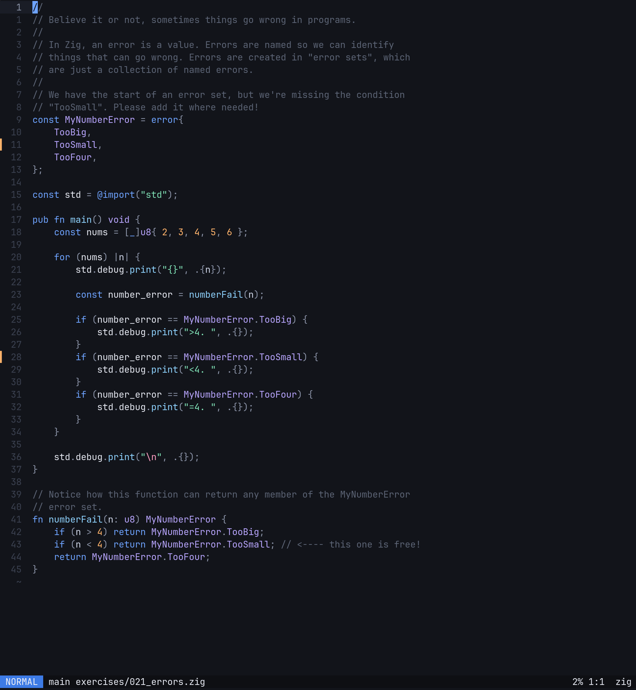
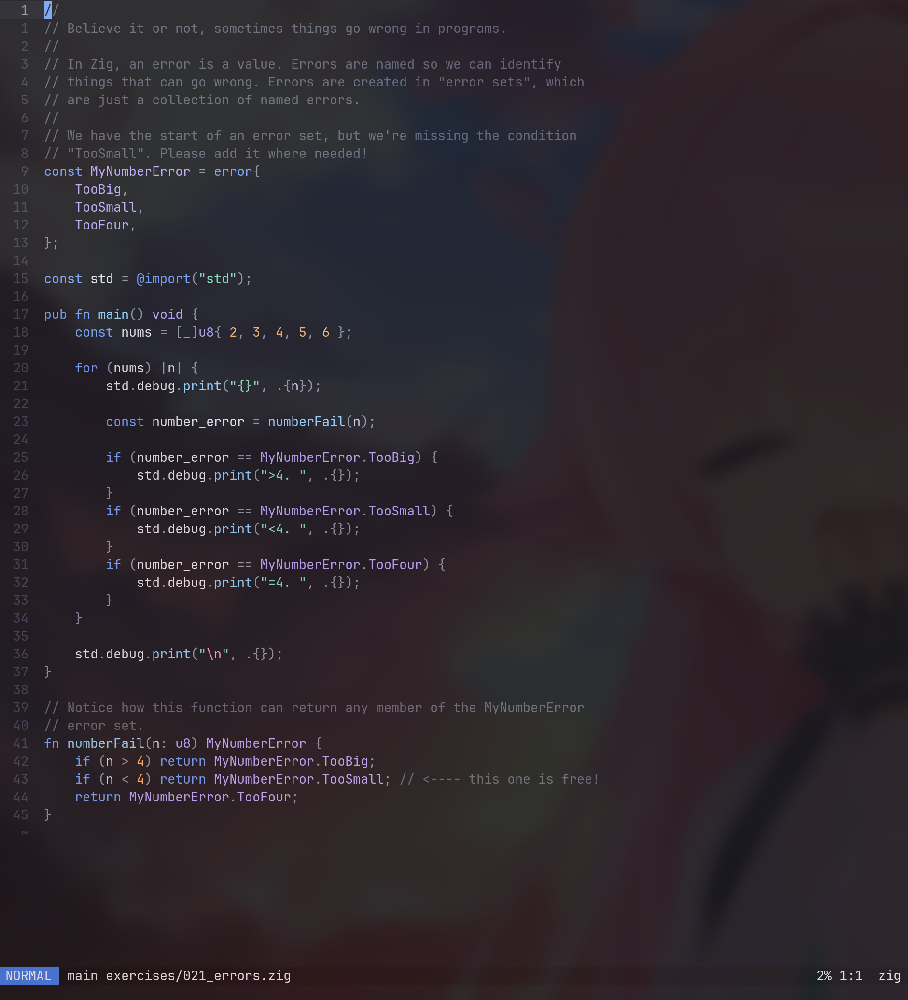

# Ferese Blue

A dark theme for Zed, Alacritty, Ghostty, Neovim, Helix, and Zellij.

<p align="center">
  
  
</p>

## Installation

The commands below use the default Linux configuration paths and require `curl`. If you use a custom configuration directory, change the destination paths accordingly.

### Neovim

```sh
mkdir -p ~/.config/nvim/colors
curl -fLo ~/.config/nvim/colors/ferese.lua \
  https://raw.githubusercontent.com/ferese-wm/ferese-blue/main/nvim/colors/ferese.lua
```

Add to `~/.config/nvim/init.lua`, after any other colorscheme setup:

```lua
vim.opt.termguicolors = true
vim.cmd.colorscheme("ferese")
```

Alternatively, with [lazy.nvim](https://lazy.folke.io/spec), add this plugin spec:

```lua
{
  "ferese-wm/ferese-blue",
  lazy = false,
  priority = 1000,
  config = function(plugin)
    vim.opt.rtp:prepend(plugin.dir .. "/nvim")
    vim.opt.termguicolors = true
    vim.cmd.colorscheme("ferese")
  end,
}
```

The runtime path points to `nvim/` because this repository contains themes for several apps. For LazyVim, also set `colorscheme = "ferese"` in the `opts` for `LazyVim/LazyVim`.

### Helix

```sh
mkdir -p ~/.config/helix/themes
curl -fLo ~/.config/helix/themes/ferese.toml \
  https://raw.githubusercontent.com/ferese-wm/ferese-blue/main/helix/ferese.toml
```

Set this at the top of `~/.config/helix/config.toml`, before any table headers:

```toml
theme = "ferese"
```

You can also switch immediately with `:theme ferese`. See the [Helix theme settings](https://docs.helix-editor.com/themes.html).

### Zed

```sh
mkdir -p ~/.config/zed/themes
curl -fLo ~/.config/zed/themes/ferese.json \
  https://raw.githubusercontent.com/ferese-wm/ferese-blue/main/zed/themes/ferese.json
```

Restart Zed, open the command palette, run `theme selector: toggle`, and select **Ferese Dark**. See [Zed's theme settings](https://zed.dev/docs/themes).

### Alacritty

```sh
mkdir -p ~/.config/alacritty/themes
curl -fLo ~/.config/alacritty/themes/ferese.toml \
  https://raw.githubusercontent.com/ferese-wm/ferese-blue/main/alacritty/ferese.toml
```

Add the theme to the `[general]` import list in `~/.config/alacritty/alacritty.toml`:

```toml
[general]
import = ["~/.config/alacritty/themes/ferese.toml"]
```

If `[general]` or `import` already exists, edit the existing table or list. Colors set directly in your main config override imported colors. See the [Alacritty configuration reference](https://alacritty.org/config-alacritty.html).

### Ghostty

```sh
mkdir -p ~/.config/ghostty/themes
curl -fLo ~/.config/ghostty/themes/ferese \
  https://raw.githubusercontent.com/ferese-wm/ferese-blue/main/ghostty/ferese
```

Set this in `~/.config/ghostty/config`:

```ini
theme = ferese
```

Remove any explicit color settings that override the theme, then reload your configuration or restart Ghostty. See [Ghostty's theme settings](https://ghostty.org/docs/features/theme).

### Zellij

```sh
mkdir -p ~/.config/zellij/themes
curl -fLo ~/.config/zellij/themes/ferese-blue.kdl \
  https://raw.githubusercontent.com/ferese-wm/ferese-blue/main/zellij/ferese-blue.kdl
```

Set this in `~/.config/zellij/config.kdl`:

```kdl
theme "ferese-blue"
```

If a `theme` setting already exists, replace its value. Zellij picks up theme changes automatically. See [Zellij's theme settings](https://zellij.dev/documentation/themes.html).
